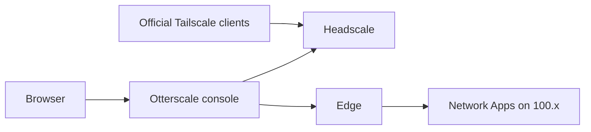

# Otterscale

Self-hosted team mesh control. No per-seat lock-in. A console on [Headscale](https://github.com/juanfont/headscale) for workspaces, tags, keys, and Network Apps — people join with **official Tailscale clients** only.

[](https://github.com/robosushie/otterscale/actions/workflows/ci-nextjs.yml)
[](https://github.com/robosushie/otterscale/actions/workflows/ci-go.yml)
[](https://github.com/robosushie/otterscale/actions/workflows/pages.yml)
[](./LICENSE)

[](https://vite.dev/)
[](https://react.dev/)
[](https://www.typescriptlang.org/)
[](https://go.dev/)
[](https://pnpm.io/)
[](https://docs.docker.com/compose/)
[](https://github.com/juanfont/headscale)
[](https://github.com/P-H-C/phc-string-format)
[](https://caddyserver.com/)
[](https://www.sqlite.org/)
[](https://github.com/robosushie/otterscale/pkgs/container/otterscale%2Fapp)

**Website:** [robosushie.github.io/otterscale](https://robosushie.github.io/otterscale/) — [features](https://robosushie.github.io/otterscale/features.html) · [deploy](https://robosushie.github.io/otterscale/deployment.html)

**Docs:** [docs/README.md](./docs/README.md) · [architecture](./docs/architecture.md) · [deployment](./docs/deployment.md) · [theme](./docs/theme.md)

## Features

- **No cap on users or devices.** Invite employees, freelancers, machines, and every server. Open source and self-hosted — no per-seat lock-in.
- **Workspaces and tags.** Workspaces decide who can access which resource. Tags give granular visibility and control. Give access controls to individual users.
- **Devices and apps, from anywhere.** Join once and reach allowed machines on the mesh. Publish a local app on `{subdomain}.{APPS_BASE_DOMAIN}` — HTTPS in front, traffic on `100.x`. This is not Funnel.
- **Official Tailscale clients only.** No custom VPN app. Add device prints `tailscale logout` then `tailscale up` pointed at your login-server.

## How it works

The browser talks to the Otterscale console. Official Tailscale clients talk to Headscale (the coordinator). Edge (Caddy TLS + Go tsnet) publishes Network Apps onto mesh IPs.



Roles are Owner, Super admin, Admin, and Member. Workspaces isolate peers. Tags are labels (`prod`, `uat`, `dev`). Local login and TOTP are always on; OIDC buttons appear when issuer, client id, and client secret are set.

## Stack

| Layer | Tools | Role |
|-------|--------|------|
| Console | Vite, React 19, Tailwind v4 | Static UI in `packages/app` |
| API | Go | `packages/core`: sessions, Headscale, SQLite or Postgres |
| Auth | Session cookie, Argon2id, TOTP, optional OIDC | Local login always on |
| Coordinator | Headscale 0.23 | Login-server, Noise, DERP map |
| Edge | Caddy, Go `packages/edge` (`tailscale.com` tsnet) | TLS + Network Apps hop |
| Clients | Official Tailscale apps | No custom VPN |
| Ship | Docker Compose, GHCR, GitHub Actions | Build, pull, Pages |
| Dev | pnpm 10, Node 22, TypeScript, Go 1.25, Vitest | CI console and CI Go |

## Quick start

Requires [Node.js 22](https://nodejs.org/), [pnpm 10.12.1](https://pnpm.io/), and an official [Tailscale client](https://tailscale.com/download) to join a device.

1. Copy env and set secrets:

   ```bash
   cp .env.example .env
   ```

   Required: `AUTH_SECRET` (≥32 chars). `DATABASE_URL` may be empty (core creates a local SQLite file), a `file:`/`sqlite:` URL, or `postgres://`. Local auth is always on. Set `AUTH_OIDC_ISSUER`, `AUTH_OIDC_CLIENT_ID`, and `AUTH_OIDC_CLIENT_SECRET` to enable SSO.

2. Run the console and API:

   ```bash
   pnpm dev
   ```

   `pnpm dev` starts the Vite console. Run the Go API with `go run ./cmd/core` from `packages/core` (it applies migrations on startup).

3. Open `/setup`. Email, then username + password (min 8), then TOTP. The first account becomes Owner. Default tags: `prod`, `uat`, `dev`.

4. On **Add device** (`/machines`), run both printed commands. Login-server is `OTTERSCALE_DOMAIN`, or `http://127.0.0.1:8080` when that env is unset:

   ```bash
   tailscale logout
   tailscale up --login-server=http://127.0.0.1:8080 --auth-key=<key>
   ```

### Docker (build local)

Requires [Docker](https://docs.docker.com/get-docker/) and Compose.

```bash
pnpm deploy:stack
pnpm deploy:stack --keep-data
```

`deploy:stack` is the multi-container product (project `otterscale`). The default **deletes that project's volumes** and starts Headscale, then the init container, then the app and edge. `--keep-data` reuses those volumes. It generates `AUTH_SECRET` in `.env` when needed. Headscale API and edge pre-auth keys are minted onto the `otterscale_secrets` volume — not `.env`. Headscale only stores a hash, so plaintext cannot be read back from SQLite. Console: `https://console.localhost`.

One container (Caddy, Headscale, console, tsnet), project `otterscale-standalone`:

```bash
pnpm deploy:standalone
pnpm deploy:standalone --keep-data
```

Same wipe-or-keep rule, but only the standalone volume. Bootstrap writes keys under `/data/secrets`. The two products do not share volumes. Starting one stops the other so ports 80/443/8080 are free, and leaves the other product's volumes in place.

If `*.localhost` does not resolve:

```text
127.0.0.1 console.localhost hs.localhost
```

Do not put `HEADSCALE_API_KEY` or `APPS_EDGE_AUTHKEY` in `.env`. `APPS_EDGE_AUTHKEY` is the pre-auth key the in-container tsnet proxy (`tag:edge`) uses to join this Headscale. Recreate with `pnpm deploy:stack` (or `--keep-data` if the secrets files are still on the volume).

## Production (GHCR)

`pnpm deploy:stack` and `pnpm deploy:standalone` build from this repo. They do not read `OTTERSCALE_IMAGE_TAG`.

Published images: `ghcr.io/robosushie/otterscale/{headscale,core,app,edge,standalone}`. Set `OTTERSCALE_IMAGE_TAG` to the tag from **Actions → Publish GHCR**. Unset, the pull files use `latest`. A semver tag also moves the Docker tag `latest`. Publishing the same tag again replaces those images. Pin `AUTH_SECRET`. Set `OTTERSCALE_DOMAIN` and `AUTH_URL`. The init container (stack) or the standalone entrypoint mints Headscale keys onto that product's volume.

Multi-container pull:

```bash
cp deployment/otterscale-stack.env.example .env
docker compose -f deployment/otterscale-stack.yaml --env-file .env up -d
```

One-container pull:

```bash
cp deployment/otterscale-standalone.env.example .env
docker compose -f deployment/otterscale-standalone.yaml --env-file .env up -d
```

Platform notes: [deployment page](https://robosushie.github.io/otterscale/deployment.html).

## Configuration

Never commit `.env`. Copy from [`.env.example`](./.env.example).

| Variable | Required | Purpose |
|----------|----------|---------|
| `DATABASE_URL` | No | Empty creates `/data/otterscale.db`. `file:`/`sqlite:` opens that file. `postgres://` uses Postgres |
| `AUTH_SECRET` | Yes | Session secret, ≥32 characters |
| `AUTH_URL` | Production | Public console origin (`https://console.localhost` locally) |
| `AUTH_OIDC_ISSUER` | Optional | OIDC issuer; SSO buttons stay off until all three OIDC vars are set |
| `AUTH_OIDC_CLIENT_ID` | Optional | OIDC client id |
| `AUTH_OIDC_CLIENT_SECRET` | Optional | OIDC client secret |
| `AUTH_SETUP_TOKEN` | Optional | Token required for first Owner signup on `/setup` |
| `HEADSCALE_INTERNAL_URL` | Docker | App → Headscale (`http://headscale:8080`) |
| `HEADSCALE_PUBLIC_URL` | Docker | Public Headscale URL |
| `OTTERSCALE_DOMAIN` | Production | Login-server for Add device (HTTPS). Unset → `http://127.0.0.1:8080` |
| `OTTERSCALE_IMAGE_TAG` | Production pull | GHCR tag for `otterscale-stack.yaml` and `otterscale-standalone.yaml`. Ignored by `pnpm deploy:stack` and `pnpm deploy:standalone` |
| `OTTERSCALE_IMAGE_PREFIX` | Optional | Registry prefix. Default `ghcr.io/robosushie/otterscale` |
| `APPS_BASE_DOMAIN` | Optional | Network Apps hostname suffix (default `apps.localhost`) |

## Development

Prereqs: Node 22, pnpm 10.12.1, [Go 1.25](./packages/core/go.mod), Docker for the stack.

| Command | Purpose |
|---------|---------|
| `pnpm dev` | Vite console |
| `pnpm test` | Vitest deploy contracts |
| `pnpm build` | Vite production build |
| `pnpm deploy:stack` | Wipe stack volumes, build, and run |
| `pnpm deploy:stack --keep-data` | Rebuild stack on existing volumes |
| `pnpm deploy:standalone` | Wipe standalone volume, build, and run |
| `pnpm deploy:standalone --keep-data` | Rebuild standalone on existing volume |
| `docker compose -f deployment/otterscale-stack.yaml --env-file .env up -d` | Pull GHCR stack images (`OTTERSCALE_IMAGE_TAG`) |
| `docker compose -f deployment/otterscale-standalone.yaml --env-file .env up -d` | Pull GHCR standalone image (`OTTERSCALE_IMAGE_TAG`) |

Schema changes are goose SQL under `packages/core/migrations`. Core applies them on startup.

UI follows [docs/theme.md](./docs/theme.md): parchment canvas, Newsreader weight 400, IBM Plex Mono, one Lake Blue primary CTA.

Commits use conventional types: `feat` · `fix` · `refactor` · `chore` · `docs` · `test` · `style`. Pull requests must pass **CI console** and **CI Go**. Do not commit secrets.

Coding agents: [AGENTS.md](./AGENTS.md).

## Repo layout

| Path | Purpose |
|------|---------|
| `packages/app` | Vite console |
| `packages/core` | Go API, database, Headscale adapter |
| `packages/edge` | Go tsnet Network Apps hop |
| `deployment/` | Compose, Caddy, Headscale, Dockerfiles |
| `site/` | GitHub Pages marketing site |
| `docs/` | Architecture, roadmap, deployment, theme |
| `tests/` | Vitest |

## Documentation

| Document | Purpose |
|----------|---------|
| [docs/README.md](./docs/README.md) | Doc index |
| [Product overview](./docs/product-overview.md) | Vision, personas, scope |
| [Architecture](./docs/architecture.md) | Components, data model, flows |
| [Roadmap](./docs/roadmap.md) | Delivery plan |
| [Deployment](./docs/deployment.md) | Images, topologies, operations |
| [Security](./docs/security.md) | Threat model, controls, audit integrity |
| [Design theme](./docs/theme.md) | Console visual system |
| [Design spec PDF](./docs/external/Otterscale_Design_Architecture.pdf) | Source specification (draft v0.5) |

## Security

Treat the control plane like an identity provider: it decides who can reach what on the mesh. Details: [docs/security.md](./docs/security.md). Never commit `.env`, API keys, or pre-auth keys.

## License

[GNU General Public License v3.0](./LICENSE). You may run, study, and share Otterscale. If you distribute a modified version, you must also provide GPL-3.0 source. Selling is allowed; a closed-source fork is not.
